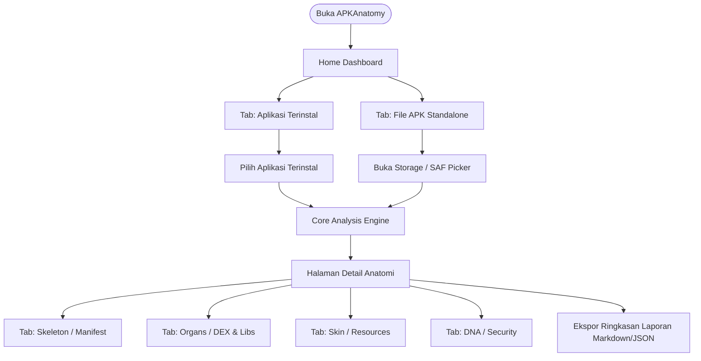

# GRAND DESIGN: APKAnatomy (Android APK Architecture & Inspector Tool)

**Nama Aplikasi:** APKAnatomy  
**Kategori:** Developer Tools / Security Auditing / Static Analysis  
**Repository:** [https://github.com/dromadi/APKAnatomy](https://github.com/dromadi/APKAnatomy)  
**Versi Dokumen:** 1.0.0 (Grand Design Release)  

---

## 1. Visi & Tujuan Proyek

**APKAnatomy** adalah aplikasi Android berbasis mobile yang dirancang sebagai sarana edukasi, riset arsitektur perangkat lunak, dan audit statis (static inspection) terhadap file APK Android. 

Aplikasi ini memungkinkan developer, mahasiswa, dan analis keamanan untuk **"membedah" dan mempelajari struktur tubuh/anatomi aplikasi lain** secara langsung dari perangkat Android tanpa ketergantungan pada PC atau dekompiler eksternal yang berat.

---

## 2. Format & Platform Aplikasi

* **Platform Target:** Android Mobile (Smartphone & Tablet)
* **Format Distribusi:** Android Application Package (`.apk`)
* **Bahasa Pemrograman:** 100% Kotlin (Modern Idiomatic Kotlin)
* **UI Toolkit:** Jetpack Compose + Material 3 (Material You Dynamic Theming)
* **Arsitektur Kode:** Clean Architecture + MVVM (Model-View-ViewModel) + Unidirectional Data Flow (UDF)
* **Kompatibilitas SDK:**
  * **Minimum SDK:** API 26 (Android 8.0 Oreo) — Memastikan dukungan terhadap Java NIO, skema verifikasi Signature v2/v3, dan API modern.
  * **Target SDK:** API 35 (Android 15) / API 36 Ready.

---

## 3. Konsep Filosofis: Empat Pilar Anatomi (The Four Anatomical Layers)

APKAnatomy membagi struktur paket aplikasi Android ke dalam 4 pilar visual:

```
┌─────────────────────────────────────────────────────────────────┐
│                           APKAnatomy                            │
├─────────────────┬──────────────────┬──────────────┬─────────────┤
│ 🦴 SKELETON     │ 🧠 ORGANS/MUSCLE │ 🎨 SKIN/UI   │ 🧬 DNA/SEC  │
│ (Kerangka)      │ (Logika & Mesin) │ (Estetika)   │ (Integritas)│
├─────────────────┼──────────────────┼──────────────┼─────────────┤
│ • Manifest XML  │ • DEX Bytecode   │ • Res Size   │ • Sig v1-v4 │
│ • Activities    │ • Native .so     │ • Assets     │ • Cert SHA  │
│ • Services      │ • Framework Type │ • Fonts      │ • Debuggable│
│ • Permissions   │ • Third-party SDK│ • Drawables  │ • Backup    │
└─────────────────┴──────────────────┴──────────────┴─────────────┘
```

### A. Pilar 1: Skeleton (Kerangka & Struktur Komponen)
* **Parser `AndroidManifest.xml`:**
  * Membaca struktur komponen: `Activity`, `Service`, `BroadcastReceiver`, `ContentProvider`.
  * **Pemeriksaan Komponen Terbuka (`exported="true"`):** Menandai komponen yang dapat diakses aplikasi lain beserta intent-filter-nya.
  * **Audit Permissions:** Memetakan daftar izin yang diminta (`Normal`, `Dangerous`, `Signature`, dan izin sensitif seperti `MANAGE_EXTERNAL_STORAGE` atau `SYSTEM_ALERT_WINDOW`).

### B. Pilar 2: Organs & Muscle (Logika Kompilasi, Bytecode & Mesin Eksekusi)
* **Metrik DEX (Dalvik Executable):**
  * Jumlah file DEX (`classes.dex`, `classes2.dex`, dst.).
  * Estimasi jumlah total method references dan alokasi bytecode.
* **Inspeksi Native Libraries (`/lib/*`):**
  * Mendeteksi dukungan Application Binary Interface (ABI): `arm64-v8a`, `armeabi-v7a`, `x86_64`.
  * Menampilkan daftar file `.so` yang disematkan.
* **Framework Fingerprint Scanner:**
  * Mendeteksi otomatis teknologi pembuat aplikasi:
    * **Pure Native:** Android Jetpack / Java / Kotlin.
    * **Cross-Platform:** Flutter (`libflutter.so`), React Native (`libreactnativejni.so`), Xamarin (`libmonodroid.so`), Unity (`libunity.so`), Godot, atau Webview/Capacitor.
* **Third-Party SDK Signatures:**
  * Mendeteksi kehadiran library populer (Networking: OkHttp/Retrofit, Database: Room/Realm, Analytics/Crashlytics, Ad Networks).

### C. Pilar 3: Skin & Aesthetics (Distribusi Resource & Tampilan)
* **Resource Storage Breakdown:**
  * Grafik visual proporsi ukuran: DEX vs Native Libraries vs Res vs Assets vs `resources.arsc`.
* **Asset & Media Inspector:**
  * Deteksi font yang disematkan (`.ttf`, `.otf`).
  * Inspeksi struktur folder `assets/` (misal web bundle, JSON schema, model AI/TFLite).

### D. Pilar 4: DNA & Immunity (Integritas, Keamanan & Sertifikat)
* **Skema Tanda Tangan (APK Signature Scheme):**
  * Deteksi skema yang aktif: v1 (JAR signing), v2 (APK Signature v2), v3 (Key rotation), v4.
* **Informasi Sertifikat Digital:**
  * Fingerprint: SHA-256, SHA-1, MD5.
  * Issuer, Subject, dan masa berlaku sertifikat (Validity period).
* **Audit Flag Keamanan:**
  * `android:debuggable` (Deteksi apakah build siap produksi atau debug).
  * `android:allowBackup` (Analisis risiko ekstraksi data lokal).
  * `android:usesCleartextTraffic` & Network Security Config (Deteksi lalu lintas data HTTP tidak terenkripsi).

---

## 4. Alur Interaksi Pengguna (User Journey & Wireframe Flow)



---

## 5. Rencana Arsitektur Modul Kode

```
app/src/main/java/com/apkanatomy/app/
│
├── core/
│   ├── parser/
│   │   ├── ApkZipReader.kt         # Membaca entri file zip dari APK mentah
│   │   ├── BinaryXmlParser.kt      # Membaca AndroidManifest binary tanpa dependensi berat
│   │   ├── DexHeaderReader.kt      # Membaca header classes.dex untuk metrik bytecode
│   │   └── SignatureVerifier.kt    # Ekstraksi sertifikat X.509 dan skema signature
│   ├── fingerprint/
│   │   ├── FrameworkDetector.kt    # Deteksi Flutter, React Native, Unity, Native
│   │   └── SdkFingerprintRules.kt  # Aturan pencocokan namespace & library
│   └── model/
│       ├── AnatomyReport.kt        # Data class representasi seluruh anatomi
│       ├── ComponentInfo.kt        # Detail Activity, Service, dll.
│       └── SecurityAuditInfo.kt    # Detail sertifikat dan flag keamanan
│
├── data/
│   ├── repository/
│   │   ├── InstalledAppRepository.kt # Integrasi dengan Android PackageManager
│   │   └── StandaloneApkRepository.kt# Integrasi dengan File / URI Storage
│
├── domain/
│   └── usecase/
│       ├── AnalyzeInstalledAppUseCase.kt
│       └── AnalyzeStandaloneApkUseCase.kt
│
└── presentation/
    ├── home/
    │   ├── HomeScreen.kt           # Daftar aplikasi terinstal & tombol picker
    │   └── HomeViewModel.kt
    ├── detail/
    │   ├── DetailAnatomyScreen.kt  # Dashboard utama anatomi aplikasi target
    │   ├── tabs/
    │   │   ├── SkeletonTab.kt      # Komponen manifest & permission
    │   │   ├── OrgansTab.kt        # DEX & Native libs
    │   │   ├── SkinTab.kt          # Breakdown resource & assets
    │   │   └── DnaSecurityTab.kt   # Sertifikat & security flags
    │   └── DetailViewModel.kt
    └── ui/
        └── theme/                  # Material 3 Color Schemes & Typography
```

---

## 6. Tahapan Pengembangan (Milestone Roadmap)

* **Fase 1 (MVP Foundation):**
  * Setup Gradle, Material 3, Navigation Compose.
  * Integrasi pembacaan aplikasi terinstal via `PackageManager`.
  * Dashboard Ringkasan: Nama aplikasi, package, icon, versi, target SDK, signature fingerprint.
* **Fase 2 (Deep Dive Parser):**
  * Dukungan pembacaan file `.apk` mandiri dari penyimpanan lokal.
  * Deteksi Native Libraries (`.so`) dan Fingerprinting Framework (Flutter/React Native/Unity).
  * Tabulasi komponen terinci (Activity, Service, Receiver, Provider dengan filter `exported`).
* **Fase 3 (Visualisasi & Polish):**
  * Visualisasi grafik proporsi ukuran file (DEX vs Libs vs Res).
  * Fitur pencarian cepat dan filtering komponen.
  * Fitur ekspor laporan audit ke format teks/markdown.
